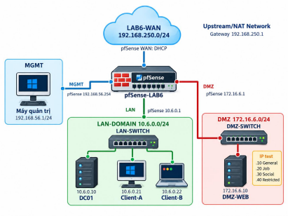
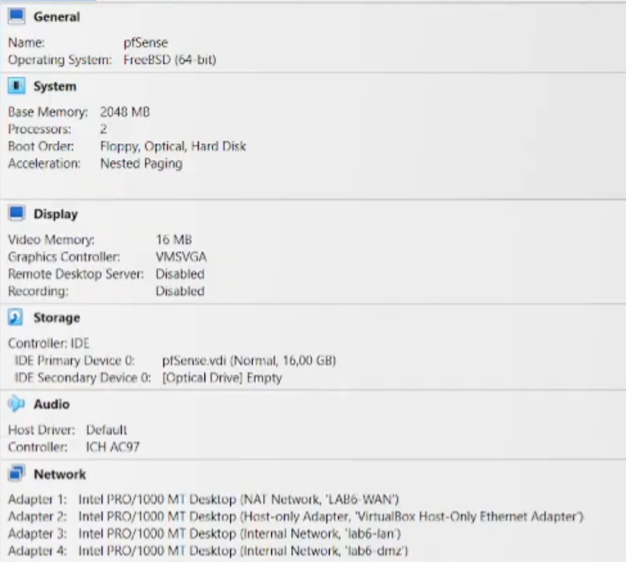
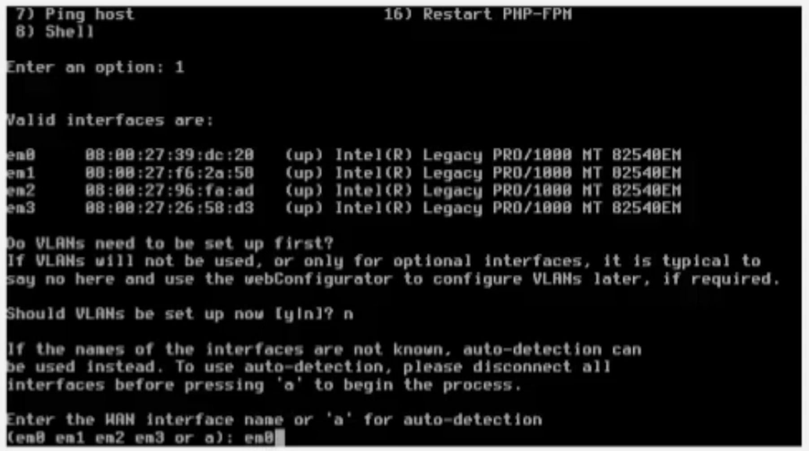
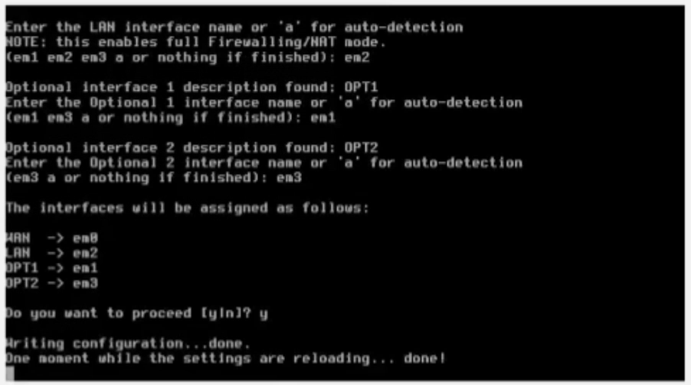
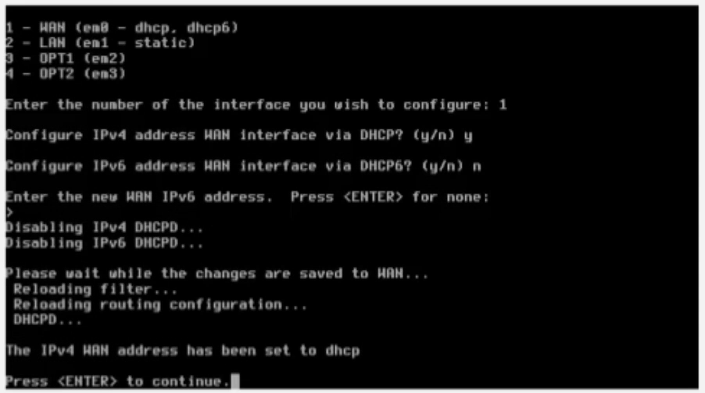
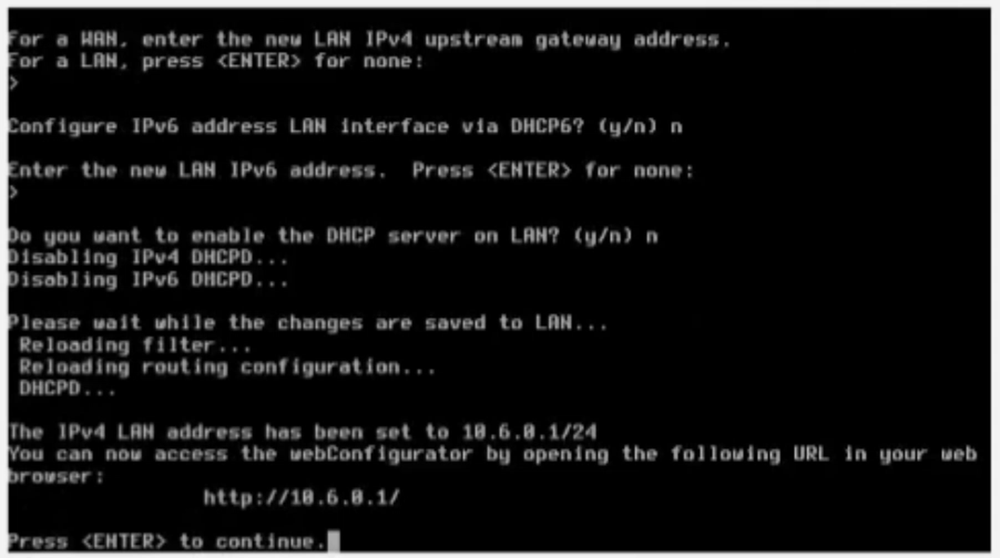
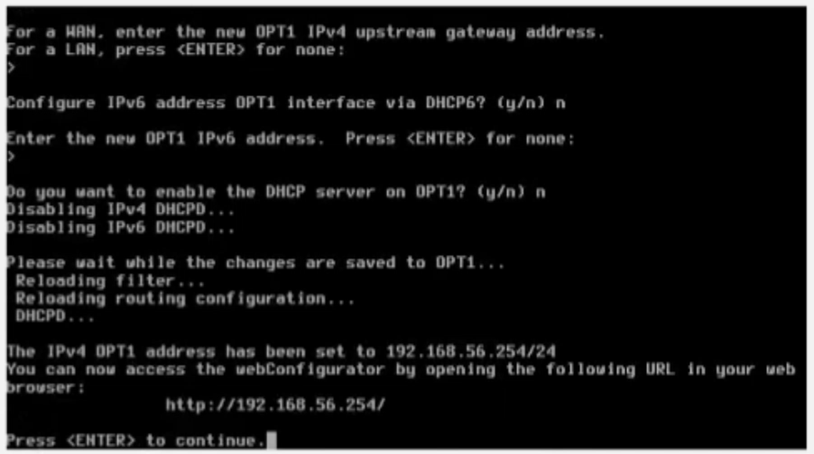
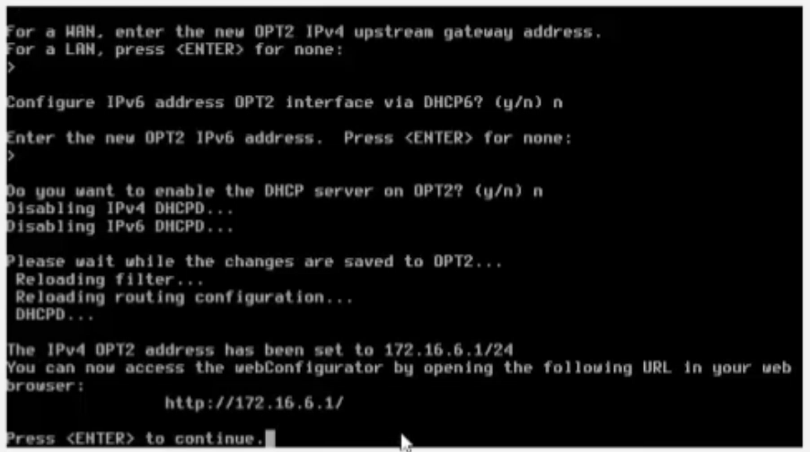
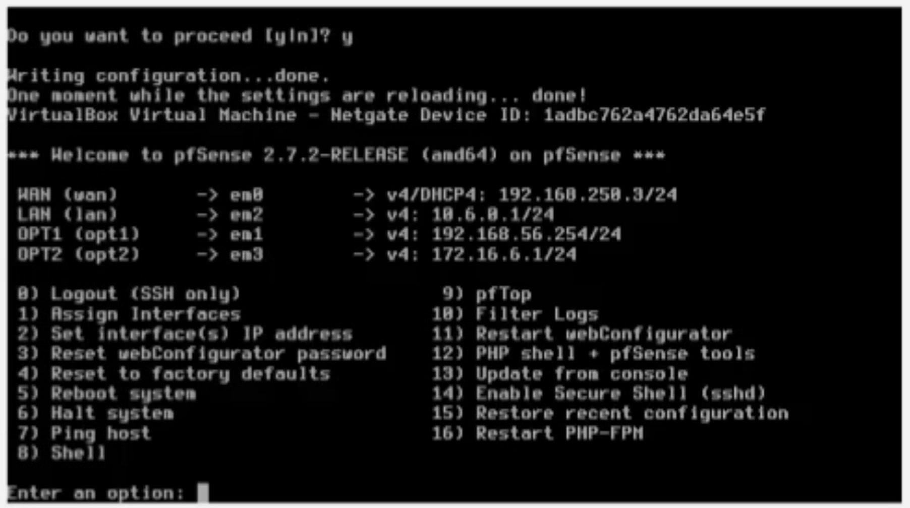
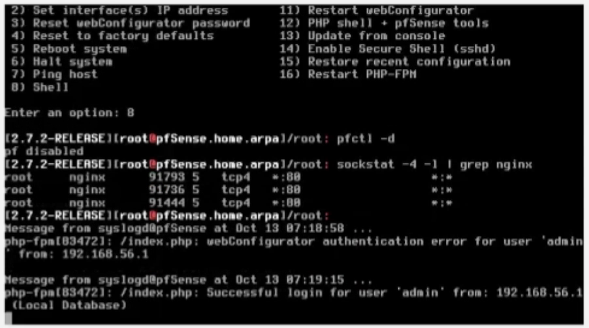

# LAB 6 – Xác thực Active Directory và chính sách truy cập trên pfSense

Báo cáo thực hành môn **An toàn hệ thống thông tin** – Bộ môn An toàn Thông tin.

## Thông tin sinh viên

| Thông tin | Nội dung |
| :-- | :-- |
| Họ và tên | Huỳnh Hữu Hoàng |
| MSSV | 1150080095 |
| Lớp | 11CNPM2 |
| Giảng viên | Phạm Trọng Huynh |
| Ngày thực hiện | 13/10/2026 |
| File báo cáo | [11CNPM2-Lab6_1150080095-HuynhHuuHoang.docx](11CNPM2-Lab6_1150080095-HuynhHuuHoang.docx) |
| Video thực hành | https://youtu.be/nb6L9AFTokU |

## Video thực hành

[](https://youtu.be/nb6L9AFTokU)

Xem trên YouTube: [https://youtu.be/nb6L9AFTokU](https://youtu.be/nb6L9AFTokU)

## Mục lục

1. [Mục tiêu bài lab](#1-mục-tiêu-bài-lab)
2. [Mô hình mạng](#2-mô-hình-mạng)
3. [Tóm tắt kết quả](#3-tóm-tắt-kết-quả)
4. [Quá trình thực hiện và ảnh minh chứng](#4-quá-trình-thực-hiện-và-ảnh-minh-chứng)
   - [4.1. Tạo các mạng ảo](#41-tạo-các-mạng-ảo)
   - [4.2. Cấu hình 4 card mạng cho pfSense-LAB6](#42-cấu-hình-4-card-mạng-cho-pfsense-lab6)
   - [4.3. Đặt IP các interface pfSense](#43-đặt-ip-các-interface-pfsense)
   - [4.4. Kiểm tra truy cập WebGUI từ máy thật](#44-kiểm-tra-truy-cập-webgui-từ-máy-thật)
5. [Trả lời câu hỏi phân tích](#5-trả-lời-câu-hỏi-phân-tích)
6. [Cấu trúc thư mục](#6-cấu-trúc-thư-mục)
7. [Ghi chú](#7-ghi-chú)

## 1. Mục tiêu bài lab

- Dựng một pfSense riêng cho LAB 6 với bốn interface: WAN, MGMT, LAN và DMZ.
- Tích hợp pfSense với Active Directory bằng LDAP và xác thực người dùng bằng *Diagnostics → Authentication*.
- Cấu hình Captive Portal trên LAN sử dụng Active Directory làm nguồn xác thực.
- Tạo Alias cho máy trạm, nhóm máy trạm và các website mô phỏng trong DMZ; thiết kế policy chặn site theo máy người dùng, chặn nhóm site, cho phép theo khung giờ và giới hạn dịch vụ.
- Hiểu giới hạn: pfSense base firewall áp policy theo IP/port/time, không biến LDAP username thành điều kiện trực tiếp của firewall rule.

## 2. Mô hình mạng



*Hình 1 – Mô hình mạng riêng của LAB 6: WAN-NAT, MGMT, LAN-DOMAIN và DMZ.*

| Thiết bị / interface | Địa chỉ | Gateway / DNS | Vai trò |
| :-- | :-- | :-- | :-- |
| pfSense WAN | DHCP trên 192.168.250.0/24 | Gateway NAT Network | Ra Internet (không dùng NAT mặc định 10.0.2.0/24) |
| pfSense MGMT | 192.168.56.254/24 | – | WebGUI riêng cho máy thật |
| Máy thật quản trị | 192.168.56.1/24 | Không gateway/DNS | Chỉ quản trị pfSense |
| pfSense LAN | 10.6.0.1/24 | – | Gateway LAN-DOMAIN |
| DC01 | 10.6.0.10/24 | GW 10.6.0.1; DNS 10.6.0.10 | AD DS + DNS, domain `lab6.test` |
| Client-A | 10.6.0.21/24 | GW 10.6.0.1; DNS 10.6.0.10 | Máy đại diện tài khoản A |
| Client-B | 10.6.0.22/24 | GW 10.6.0.1; DNS 10.6.0.10 | Máy đại diện tài khoản B |
| pfSense DMZ | 172.16.6.1/24 | – | Gateway DMZ |
| DMZ-WEB | 172.16.6.10/24 | GW 172.16.6.1 | Nginx; thêm IP .20/.30/.40 để mô phỏng nhóm website |

## 3. Tóm tắt kết quả

| Bước | Cấu hình chính | Kết quả | Minh chứng |
| :-- | :-- | :-- | :-- |
| Tạo mạng ảo | VirtualBox: NAT Network `LAB6-WAN`, Host-Only 192.168.56.0/24, Internal `lab6-lan`, `lab6-dmz` | Đủ 4 mạng ảo; WAN nhận 192.168.250.3/24 qua DHCP | Hình B.1, B.4 |
| Máy ảo pfSense | FreeBSD 64-bit, 2048 MB RAM, 2 vCPU, ổ 16 GB, 4 card Intel PRO/1000 MT | 4 adapter gắn đúng 4 mạng | Hình B.1 |
| Gán interface | Console *1) Assign Interfaces*, đối chiếu MAC | WAN = em0, LAN = em2, OPT1 (MGMT) = em1, OPT2 (DMZ) = em3 | Hình B.2, B.3 |
| Đặt IP | Console *2) Set interface(s) IP address* | WAN DHCP 192.168.250.3/24; LAN 10.6.0.1/24; MGMT 192.168.56.254/24; DMZ 172.16.6.1/24; tắt DHCP Server | Hình B.4 – B.8 |
| WebGUI | Shell: `pfctl -d`, `sockstat -4 -l \| grep nginx` | nginx lắng nghe TCP/80; đăng nhập admin thành công từ 192.168.56.1 | Hình B.9 |

## 4. Quá trình thực hiện và ảnh minh chứng

Mỗi bước dưới đây ghi lại thao tác đã làm, kết quả quan sát được và ảnh chụp màn hình tương ứng. Số hình trùng với số hình trong file báo cáo Word.

### 4.1. Tạo các mạng ảo

**Thực hiện** (mục B.1 trong báo cáo), trong VirtualBox Network Manager:

1. Tạo NAT Network **LAB6-WAN**, subnet `192.168.250.0/24`, bật DHCP.
2. Dùng Host-Only Network `192.168.56.0/24` cho MGMT; máy thật dùng `192.168.56.1/24`, không đặt Default Gateway và DNS trên card này.
3. Tạo Internal Network **lab6-lan** cho vùng LAN-DOMAIN.
4. Tạo Internal Network **lab6-dmz** cho vùng DMZ.

**Kết quả:** VirtualBox có đủ 4 mạng ảo dùng cho LAB 6 và cả 4 được gắn vào 4 adapter của VM pfSense (Hình B.1). Khi pfSense khởi động, WAN nhận địa chỉ **192.168.250.3/24** qua DHCP (Hình B.4), chứng tỏ NAT Network LAB6-WAN dùng đúng subnet và đã bật DHCP. Máy thật truy cập pfSense từ địa chỉ 192.168.56.1 trên mạng Host-Only (Hình B.9).

### 4.2. Cấu hình 4 card mạng cho pfSense-LAB6

**Thực hiện** (mục B.2 trong báo cáo):

1. Máy ảo pfSense (FreeBSD 64-bit) được cấp **2048 MB RAM, 2 vCPU**, ổ đĩa `pfSense.vdi` **16 GB** và 4 card mạng Intel PRO/1000 MT Desktop:

   | Adapter | VirtualBox mode | Tên mạng | Vai trò |
   | :-- | :-- | :-- | :-- |
   | Adapter 1 | NAT Network | LAB6-WAN | WAN |
   | Adapter 2 | Host-Only Adapter | VirtualBox Host-Only Ethernet Adapter (192.168.56.0/24) | MGMT |
   | Adapter 3 | Internal Network | lab6-lan | LAN |
   | Adapter 4 | Internal Network | lab6-dmz | DMZ |

2. Khởi động pfSense **2.7.2-RELEASE**, trên console chọn **1) Assign Interfaces**. pfSense nhận đủ 4 card em0 – em3 kèm địa chỉ MAC; không cấu hình VLAN (chọn `n`).
3. Đối chiếu thứ tự Adapter của VirtualBox với MAC rồi gán: **WAN = em0, LAN = em2, OPT1 = em1** (dùng làm MGMT), **OPT2 = em3** (dùng làm DMZ), xác nhận `y`. Lần gán đầu LAN bị gán vào em1 và OPT1 vào em2; sau khi đối chiếu lại MAC, thực hiện Assign Interfaces thêm một lần để gán đúng.

**Bảng ánh xạ interface sau khi gán:**

| Interface pfSense | Card | MAC address | Adapter VirtualBox | Vai trò |
| :-- | :-- | :-- | :-- | :-- |
| WAN | em0 | 08:00:27:39:dc:28 | Adapter 1 – NAT Network LAB6-WAN | WAN |
| OPT1 | em1 | 08:00:27:f6:2a:58 | Adapter 2 – Host-Only 192.168.56.0/24 | MGMT |
| LAN | em2 | 08:00:27:96:fa:ad | Adapter 3 – Internal lab6-lan | LAN |
| OPT2 | em3 | 08:00:27:26:58:d3 | Adapter 4 – Internal lab6-dmz | DMZ |



*Hình B.1 – Cấu hình VM pfSense trong VirtualBox với 4 adapter: LAB6-WAN, Host-Only, lab6-lan, lab6-dmz.*



*Hình B.2 – Console pfSense liệt kê 4 interface em0 – em3 kèm địa chỉ MAC.*



*Hình B.3 – Gán interface: WAN → em0, LAN → em2, OPT1 → em1, OPT2 → em3.*

### 4.3. Đặt IP các interface pfSense

**Thực hiện** (mục B.3 trong báo cáo): trên console chọn **2) Set interface(s) IP address** và cấu hình lần lượt từng interface:

- **WAN (em0):** IPv4 qua DHCP, không dùng DHCPv6 → nhận `192.168.250.3/24` từ LAB6-WAN.
- **LAN (em2):** tĩnh `10.6.0.1/24`, không upstream gateway, không IPv6, **không bật DHCP Server** (client dùng IP tĩnh để policy dễ kiểm chứng).
- **OPT1 – MGMT (em1):** tĩnh `192.168.56.254/24`, không gateway, không IPv6, không bật DHCP Server.
- **OPT2 – DMZ (em3):** tĩnh `172.16.6.1/24`, không gateway, không IPv6, không bật DHCP Server.

**Kết quả:** console pfSense hiển thị cấu hình cuối cùng:

| Interface | Card | IPv4 | DHCP Server |
| :-- | :-- | :-- | :-- |
| WAN (wan) | em0 | DHCP – 192.168.250.3/24 | – |
| LAN (lan) | em2 | 10.6.0.1/24 | Tắt |
| OPT1 (MGMT) | em1 | 192.168.56.254/24 | Tắt |
| OPT2 (DMZ) | em3 | 172.16.6.1/24 | Tắt |



*Hình B.4 – Cấu hình WAN nhận IPv4 qua DHCP.*



*Hình B.5 – Đặt IP LAN 10.6.0.1/24, tắt DHCP Server.*



*Hình B.6 – Đặt IP OPT1 (MGMT) 192.168.56.254/24, tắt DHCP Server.*



*Hình B.7 – Đặt IP OPT2 (DMZ) 172.16.6.1/24, tắt DHCP Server.*



*Hình B.8 – Trạng thái các interface của pfSense-LAB6 sau khi cấu hình.*

### 4.4. Kiểm tra truy cập WebGUI từ máy thật

**Thực hiện:**

1. Trên console chọn **8) Shell**, tạm tắt packet filter bằng `pfctl -d`.
2. Chạy `sockstat -4 -l | grep nginx` để xác nhận webConfigurator (nginx) đang lắng nghe cổng **TCP/80**.
3. Từ máy thật (192.168.56.1) truy cập `http://192.168.56.254` và đăng nhập.

**Kết quả:** syslog của pfSense ghi nhận lần đăng nhập đầu sai mật khẩu (07:18:58), lần tiếp theo **đăng nhập thành công tài khoản admin từ 192.168.56.1** bằng Local Database (07:19:15) → máy thật quản trị được pfSense qua interface MGMT.



*Hình B.9 – Shell pfSense: `pfctl -d`, kiểm tra nginx và log đăng nhập WebGUI thành công từ 192.168.56.1.*

## 5. Trả lời câu hỏi phân tích

Tóm tắt câu trả lời; bản đầy đủ nằm ở mục J của file báo cáo.

<details>
<summary>Câu 1 – 9</summary>

1. **Vì sao LAB 6 dùng topology riêng:** LAB 6 cần pfSense 4 interface với các subnet riêng (192.168.250.0/24, 192.168.56.0/24, 10.6.0.0/24, 172.16.6.0/24), Domain Controller `lab6.test`, client IP tĩnh và DMZ-WEB nhiều IP. Dùng lại cấu hình LAB 5 thì rule, alias, NAT, DHCP cũ vẫn tham gia xử lý gói tin, không biết kết quả do rule nào, dễ trùng subnet. Topology riêng giúp cô lập lỗi, tái lập kết quả, snapshot độc lập và không làm hỏng LAB 5.
2. **LDAP trên pfSense và username trong rule:** LDAP là nguồn xác thực ngoài – pfSense bind vào Active Directory để kiểm tra username/password và nhóm, dùng cho Captive Portal, đăng nhập WebGUI, VPN, kiểm tra bằng *Diagnostics → Authentication*. Firewall rule chuẩn không dùng username AD làm Source vì pf chỉ khớp interface, giao thức, IP/alias, port, schedule; muốn áp policy theo người dùng phải ánh xạ người dùng sang IP (như alias CLIENT_A, CLIENT_B) hoặc dùng VPN/proxy có xác thực.
3. **Captive Portal trên LAN, WebGUI trên MGMT:** Portal phải đặt ở interface người dùng kết nối (LAN) để chặn và chuyển hướng tới trang đăng nhập. WebGUI tách sang MGMT để người dùng LAN không tiếp cận được trang quản trị, và quản trị viên không bị portal hay rule LAN chặn mất đường vào. Trong bài, WebGUI được truy cập từ 192.168.56.1 qua MGMT 192.168.56.254 (Hình B.9).
4. **Search Scope Entire Subtree:** One Level chỉ tìm ngay dưới Base DN, còn Entire Subtree tìm đệ quy toàn bộ cây con. User/group trong AD thường nằm trong OU lồng nhau (OU=LAB6-Users,DC=lab6,DC=test) nên Entire Subtree bảo đảm tìm thấy sv_a, sv_b dù ở OU con nào.
5. **Service account thay vì Domain Administrator:** tài khoản bind chỉ cần quyền đọc thư mục (đặc quyền tối thiểu). Mật khẩu bind lưu trong config.xml và bản backup; nếu lộ mà là Domain Administrator thì mất cả domain. LDAP TCP/389 không mã hóa nên credential còn có thể bị bắt gói. Service account riêng dễ đổi mật khẩu, dễ theo dõi log, khóa riêng được.
6. **Rule Block SOCIAL_SITE dưới rule Pass có Schedule:** khi schedule không active, rule Pass coi như không tồn tại chứ không tự đổi thành Block; gói tin đi tiếp xuống dưới và có thể khớp một rule Pass rộng hơn. Rule Block ngay bên dưới bảo đảm ngoài giờ nghỉ bị chặn tường minh; trong giờ nghỉ rule Pass ở trên khớp trước.
7. **DNS tới 10.6.0.10 không cần rule:** Client-A/B và DC01 cùng subnet 10.6.0.0/24 nên truy vấn DNS đi thẳng ở lớp 2, không qua gateway 10.6.0.1; pfSense không thấy luồng này. Chỉ cần cho DC01 truy vấn DNS upstream qua pfSense.
8. **First-match:** pfSense xét rule từ trên xuống, rule khớp đầu tiên quyết định. Ví dụ 10:00 Client-A vào 172.16.6.20 khớp rule 1 *Block CLIENT_A → JOB_SITE* nên bị chặn dù rule 6 *Pass POLICY_CLIENTS → Any WEB_PORTS + WORK_HOURS* cũng khớp; nếu đưa rule 6 lên đầu thì Client-A lại vào được JOB_SITE.
9. **Tạo kết nối mới hoặc Reset States sau khi đổi rule:** pfSense là firewall stateful – gói tiếp theo của kết nối đã Pass khớp state table mà không đánh giá lại rule. State cũ không tự mất khi đổi rule, nên phải tạo kết nối mới hoặc *Diagnostics → States → Reset States* để lưu lượng được đánh giá theo ruleset mới.

</details>

## 6. Cấu trúc thư mục

```
LAB6_AT-BMHTTT/
├── README.md                                     # tệp này
├── 11CNPM2-Lab6_1150080095-HuynhHuuHoang.docx    # báo cáo chính
└── images/                                       # sơ đồ mô hình + ảnh minh chứng Hình B.1 – B.9 (trích từ báo cáo)
```

## 7. Ghi chú

- Bài làm dùng VirtualBox theo đúng tài liệu hướng dẫn: NAT Network `LAB6-WAN`, Host-Only `192.168.56.0/24`, Internal Network `lab6-lan` và `lab6-dmz`; pfSense CE 2.7.2-RELEASE.
- Tên card (em0 – em3) phụ thuộc loại card mạng ảo, nên vai trò từng interface được xác định bằng thứ tự Adapter và địa chỉ MAC chứ không dựa vào tên.
- Phạm vi: chỉ cấu hình trên các máy ảo do chính sinh viên dựng trong mạng lab cô lập, phục vụ học tập và nghiên cứu, không nhằm mục đích phá hoại.
